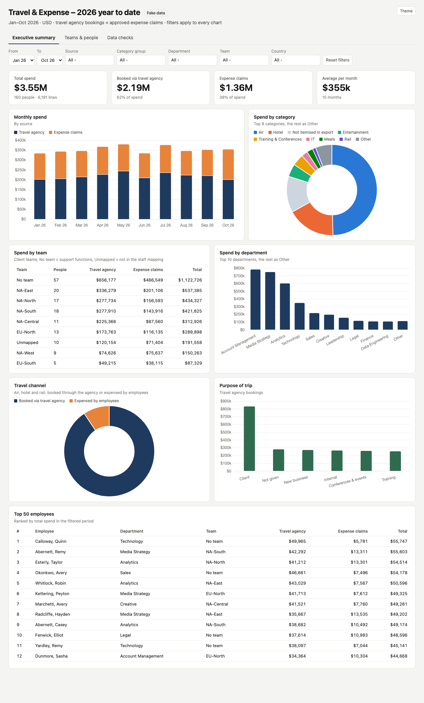

# Travel & Expense Dashboard

Combines **travel agency bookings** (air, hotel, rail) and **approved employee expense claims** into one table of spend in
USD. The data is cleaned and tied out, people are mapped to departments and teams, and the result feeds an executive
dashboard. It's built on Databricks, and there's also a static HTML copy of the dashboard that runs anywhere.

> **All data in this repository is fake.** The people, cost centers, hotels, airlines, rail operators, company entities and
> amounts are generated by `scripts/generate_fake_data.py`. Names are invented, and nothing comes from a real company.



**View the dashboard:** open `docs/index.html` in a browser. Or turn on GitHub Pages (Settings → Pages → branch `main`,
folder `/docs`) and it's served at `https://<you>.github.io/<repo>/`.

## The problem

Travel and expense spend sat in three exports that did not line up:

- **Travel agency bookings**: one workbook with Air, Hotel and Rail tabs. Some extracts repeat a hotel stay under both the
  hotel group and the brand name. Some bookings are in local currency but sit in the USD column. Hidden tabs hold old copies.
- **Expense claims export**: one line per report, but the report total covers the whole report, so a plain sum of the lines
  understates spend.
- **Staff mapping**: employee → cost center, department, team. It's a few months out of date, so new joiners are missing.

## What this builds

```
 data/*.xlsx ─► notebook "Spend Unified" ─► spend_unified        ─► Databricks dashboard (dashboard/*.lvdash.json)
                                         ├► agency_adjustments  ─► static dashboard   (docs/index.html + data.js)
                                         └► load_checks
```

| Output | What it holds |
|---|---|
| `spend_unified` | One row per agency booking or expense line, in USD. Each row has source, category group / category, employee, country, entity, date, month, department, cost center group, team, how the person was matched (`match_method`) and how the amount was derived (`line_basis`). |
| `agency_adjustments` | Every agency row the build changed or removed, with the original and kept amounts. |
| `load_checks` | Tie-out of each run: file totals → adjustments → what was loaded. The notebook fails if the totals don't tie. |

**Fixes the notebook applies**

1. **Currency:** hotel rows in a listed country whose nightly rate is impossibly high are converted to USD (yen in the demo).
2. **Duplicates:** hotels are de-duplicated on traveler + invoice date + check-in + check-out + nights + amount, and air and
   rail on identical rows.
3. **Expense claims:** each report is counted at its report total in USD. Lines in the export keep their expense type; the
   rest of a partly-exported report becomes *Not itemised in export*.
4. **Period:** only calendar 2026 is kept. Older claims are left out and counted in `load_checks`.
5. **People:** department comes from the cost center the expense was charged to. Travellers take the cost center from their
   own expense claims. Team comes from the staff mapping by employee ID, else by name. Anyone not found is *Unmapped*.

**Dashboard pages**

- **Executive summary:** total, agency and claims KPIs plus the monthly average; monthly spend by source; spend by
  category; spend by team; spend by department; travel channel; purpose of trip; top 50 employees.
- **Teams & people:** spend by team, by department and by country.
- **Data checks:** how the numbers are built, the tie-out, how each amount was derived, the adjustments made, and people
  missing from the staff mapping.

Filters for month range, source, category group, department, team and country apply to every chart.

### Problems planted in the fake data

The generator plants problems so the fixes and checks have something to find:

| Problem | Demo result |
|---|---|
| September hotel stays repeated under the group name, plus repeated air rows | 48 rows removed, −$58k |
| One October week of Tokyo hotel stays in yen | 3 stays converted, −$211k |
| Partly-exported expense reports | $458k *Not itemised in export* |
| 4 claims dated December 2025 | $185 left out |
| 10 new hires missing from the staff mapping | shown as *Unmapped* |

Result: $3.55M of spend, of which $2.19M was booked via the travel agency and $1.36M came through expense claims, across
160 people.

## Run it on Databricks

You need a Unity Catalog schema, a SQL warehouse, the `databricks` CLI (logged in) and perl.

```sh
S=<catalog>.<schema>                    # e.g. main.travel_expense_demo
databricks schemas create ${S#*.} ${S%%.*}
databricks volumes create ${S%%.*} ${S#*.} raw_files MANAGED
for f in data/*.xlsx; do databricks fs cp "$f" "dbfs:/Volumes/${S/./\/}/raw_files/$(basename "$f")"; done
```

1. Import `notebooks/spend_unified.py` into your workspace. Run it with the widget `schema` = `$S` (serverless works).
2. Create the dashboard: `DATABRICKS_WAREHOUSE_ID=<id> scripts/deploy_dashboard.sh $S "/Users/<you>/<folder>"`.
3. Optional: rebuild the static dashboard's data from your tables with
   `DATABRICKS_WAREHOUSE_ID=<id> scripts/export_html_data.sh $S`.

To regenerate the fake files: `python scripts/generate_fake_data.py data/` (needs pandas + openpyxl). The seed is fixed,
so it gives the same files every time.

## Repository layout

```
data/        fake input workbooks (travel agency bookings, expense claims, staff mapping)
notebooks/   spend_unified.py – the Databricks notebook (source format)
dashboard/   travel_expense.lvdash.json – Databricks AI/BI dashboard ({{schema}} is filled in by deploy_dashboard.sh)
docs/        index.html + data.js – static dashboard (Chart.js), screenshot.png
scripts/     generate_fake_data.py, deploy_dashboard.sh, export_html_data.sh
```
